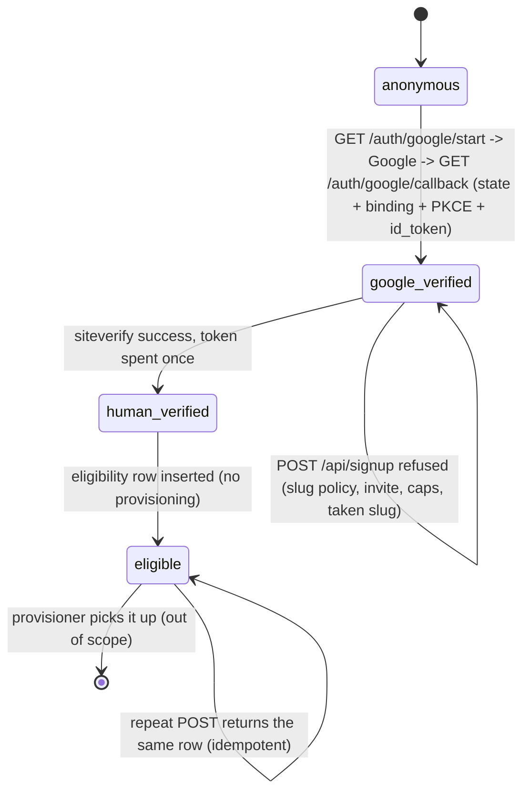

# Sign-up gate: implementation notes

Branch `feat/google-signup-gate` (worktree `../hoja-signup`, based on
`chore/rename-cliniar-to-hoja`). Specs: `Hoja-Cloud/docs/google-sso-design.md`
and `Hoja-Cloud/docs/signup-security.md`.

Scope: identity, humanity, eligibility. **No provisioning**: nothing here
creates a database, container, Traefik route or DNS record, and nothing in the
request path calls a provisioner. Cloudflare was not touched.

## 1. The state machine as implemented



Transitions and where each is enforced:

| Transition | Enforced by | Evidence recorded |
| --- | --- | --- |
| `anonymous -> google_verified` | `hoja_server/google_oidc.py` (`verify_id_token`) + `hoja_server/app.py` callback | `signup_identity` row, `signup_session` row, `hoja_signup_session` cookie |
| `google_verified -> human_verified` | `hoja_server/turnstile.py` (siteverify) + `signup_store.consume_turnstile_token` | `turnstile_use` row keyed by token hash |
| `human_verified -> eligible` | `hoja_server/signup_gate.py` (mode, invite, caps, slug) | `signup_eligibility` row, `status='eligible'`, `claimed_at NULL` |

### Google OIDC (`hoja_server/google_oidc.py`)

- Authorization-code flow, `response_type=code`, `scope=openid email profile`
  (no offline access, so no Google refresh token is ever stored).
- PKCE `S256` always; the verifier is stored server-side in `signup_flow` and
  sent to the token endpoint with the code.
- `state` (32 random bytes), `nonce` (32 random bytes) and a browser *binding*
  secret are created per flow. The browser gets only the binding in a
  short-lived (`600 s`) `HttpOnly`/`SameSite=Lax` `hoja_oidc_flow` cookie; the
  state hash, nonce and verifier stay in the database.
- `consume_flow` is single use: a guarded `UPDATE ... WHERE consumed_at IS NULL`
  means a second callback with the same `state` matches no row. A *wrong*
  binding does not consume the flow, so the rightful browser can still finish.
- `id_token` checks, in this order: exactly three segments → header is JSON →
  `alg == RS256` (explicitly refusing `none` and every `HS*`) → `kid` looked up
  in Google's JWKS → RSASSA-PKCS1-v1_5/SHA-256 signature → `iss` is Google →
  `aud` is our client id (multi-audience tokens must carry matching `azp`) →
  `exp` in the future, `iat` not in the future (120 s skew) → `nonce` equals
  this flow's nonce → `email_verified is True` → `sub` non-empty.
- `sub` is the identity key: `signup_identity` is unique on
  `(provider='google', subject)`. `email` is display/policy only.
- JWKS is cached for one hour; an `unknown_key` refusal triggers exactly one
  refetch before the token is refused, so a Google key rotation does not lock
  people out.

### Session (`hoja_server/signup_store.py`, `app.py`)

Opaque 48-byte token in `hoja_signup_session`; only its SHA-256 is stored
(`signup_session.token_hash`), the same machinery as `browser_session`: row
lookup per request, `revoked_at`, `expires_at` (30 days), rotation on every
login (the presented session is revoked in the same transaction that creates
the new one).

Cookie attributes: `HttpOnly`, `SameSite=Lax`, `Path=/`, no `Domain`,
`Max-Age=30d`, and `Secure` on every non-loopback request. `Lax` (not `Strict`)
is required: the OAuth callback is a top-level cross-site GET and a `Strict`
cookie would not be sent.

Two deliberate deviations from the design document, both because of the
existing schema:

1. **A separate `signup_session` table, not `browser_session`.**
   `browser_session.user_id` and `.organization_id` are `NOT NULL` foreign keys
   to `user`/`organization`; a person who is signing up has no workspace yet, so
   no such row can exist. Inventing a placeholder org would be worse than a
   second table with identical semantics. The pattern (opaque token, hash at
   rest, revoke, rotate) is copied exactly.
2. **`hoja_signup_session` / `hoja_oidc_flow`, not `__Host-hoja_session` /
   `__Host-hoja_oidc`.** The `hoja_session` name is already taken by the
   existing tenant session — reusing it would let a pre-tenant cookie be read as
   a workspace session — and the `__Host-` prefix forbids the loopback dev
   exemption the app already relies on. `Secure`, `Path=/` and "no Domain" are
   set explicitly instead.

No password endpoint, password reset, magic link, OTP or outbound email was
added (`rg -i "password_hash|set_password"` is byte-identical to the base
branch — see §5).

### Turnstile (`hoja_server/turnstile.py`)

`POST https://challenges.cloudflare.com/turnstile/v0/siteverify` with
`secret`, `response` (the token) and `remoteip` (the client address from
`CF-Connecting-IP`/`X-Forwarded-For` when behind the trusted proxy). The
response must be `success: true` **and** echo the expected `hostname`; an
`action` can be required when a widget sets one. There is no hostname *input*
parameter in the API, so "expected hostname" is enforced on the response.

Single use is enforced twice: `turnstile_use.token_hash` is a primary key, so a
spent token fails on insert (`turnstile_replayed`), and Cloudflare independently
answers `timeout-or-duplicate` for a token it has already seen. A missing,
failed or replayed token never reaches `eligible` (tests assert no
`signup_eligibility` row exists after each).

### The gate endpoint (`POST /api/signup`)

Request: `{"slug": "<name>", "turnstileToken": "<token>"}` (cookie-authenticated;
same-origin required — a cross-site `Origin` is refused as `cross_site_request`).

Success (`201`, or `200` for an idempotent repeat):

```json
{
  "ok": true, "state": "eligible", "reason": null,
  "message": "Your workspace request is queued.",
  "googleVerified": true, "humanVerified": true,
  "eligibilityId": "...", "slug": "acme", "status": "eligible",
  "alreadyEligible": false
}
```

The provisioner's contract is a query, not a call:
`SELECT * FROM signup_eligibility WHERE status = 'eligible' AND claimed_at IS NULL`.
`idempotency_key = sha256(sub \0 slug)`, plus unique `slug` and unique
`(google_sub, slug)`, so a retried request cannot enqueue two workspaces.

## 2. Refusal reason codes (stable, machine-readable)

Every refusal is `{"ok": false, "state": <state>, "reason": <code>, "message": ...}`.
Callers may branch on `reason`; `state` says how far the request got.

| `reason` | HTTP | `state` | Meaning |
| --- | --- | --- | --- |
| `signup_unconfigured` | 503 | `anonymous` | no Google/Turnstile credentials on this deployment |
| `not_authenticated` | 401 | `anonymous` | no live Google-verified session |
| `signup_closed` | 403 | `google_verified` | `HOJA_SIGNUP_MODE=closed` (the default) |
| `domain_not_allowed` | 403 | `google_verified` | `hd` claim is not `HOJA_GOOGLE_HD` |
| `slug_required` | 422 | `google_verified` | no slug supplied |
| `invalid_slug` | 422 | `google_verified` | not a DNS label (case, length, hyphens, punycode) |
| `reserved_slug` | 403 | `google_verified` | name on the reserved list (`www`, `app`, `api`, …) |
| `turnstile_missing` | 403 | `google_verified` | no token in the body |
| `turnstile_failed` | 403 | `google_verified` | siteverify refused, or the token was minted for another host |
| `turnstile_replayed` | 403 | `human_verified` | the token was already spent |
| `invite_required` | 403 | `human_verified` | `mode=invite` and this address has no open invitation |
| `identity_cap_exceeded` | 429 | `human_verified` | this Google account already has its workspace request |
| `ip_cap_exceeded` | 429 | `human_verified` | too many requests from this address in the window |
| `slug_taken` | 409 | `human_verified` | the name is queued or provisioned |
| `cross_site_request` | 403 | — | `Origin` is not this host (cookie-authenticated POST) |
| `invalid_request` | 400/413 | — | body is not a JSON object, or too large |

Login-endpoint codes: `state_unknown`, `state_binding_mismatch` (a flow started
in another browser), `state_replayed`, `state_expired`, `redirect_uri_not_allowed`,
`provider_error`, `code_missing`, `exchange_failed`, `alg_none`,
`alg_not_allowed`, `bad_signature`, `unknown_key`, `issuer_mismatch`,
`audience_mismatch`, `token_expired`, `token_not_yet_valid`, `nonce_mismatch`,
`email_unverified`, `claim_missing`, `subject_missing`, `malformed`.

Order of evaluation is cheapest-first and does not depend on a token being
present: mode → domain → slug syntax/reserved → Turnstile → idempotent repeat →
invite → caps → taken slug → eligible. An invalid label is therefore refused
without spending a Turnstile token.

## 3. Environment variables

Required whenever `HOJA_SIGNUP_MODE` is not `closed`. Missing any one of them
(or setting only some of them) raises `SignupConfigError` **at app startup**,
so a half-configured deployment cannot start and cannot silently allow.

| Variable | Required | Default | Notes |
| --- | --- | --- | --- |
| `HOJA_SIGNUP_MODE` | no | `closed` | `closed` \| `invite` \| `open`; anything else is a startup error |
| `GOOGLE_CLIENT_ID` | yes | — | OIDC client id; also the `aud` we require |
| `GOOGLE_CLIENT_SECRET` | yes | — | confidential client, exchanged server-side |
| `GOOGLE_REDIRECT_URI` | yes | — | exact URI; `https` (http only for loopback); no query/fragment |
| `TURNSTILE_SECRET_KEY` | yes | — | siteverify secret |
| `TURNSTILE_EXPECTED_HOSTNAME` | yes | — | bare hostname the widget is registered for |
| `GOOGLE_REDIRECT_URI_ALLOWLIST` | no | `GOOGLE_REDIRECT_URI` | comma-separated exact URIs, one host each |
| `HOJA_GOOGLE_HD` | no | unset | require this Workspace domain in the `hd` claim |
| `HOJA_SIGNUP_IDENTITY_CAP` | no | `1` | workspace requests per Google account |
| `HOJA_SIGNUP_IP_CAP` | no | `2` | workspace requests per client address per window |
| `HOJA_SIGNUP_IP_WINDOW_SECONDS` | no | `86400` | window for the IP cap |
| `HOJA_TENANT_REGISTRY` | no | unset | `Hoja-Cloud/tenants/registry.json`, so provisioned slugs also count as taken |

## 4. What the tests mock, and what they prove

`tests/test_signup_gate.py` — 81 tests. Only the network seams are replaced:

- `turnstile._http_post_form` → a canned siteverify (also records the exact
  `secret`/`response`/`remoteip` posted).
- `google_oidc._http_post_form` → the token endpoint, returning a token the test
  signs with its own RSA key.
- `google_oidc._http_get_json` → a JWKS the test builds from that key.

An autouse fixture replaces `httpx.get`/`httpx.post` with a function that raises,
so any accidental outbound call fails the test. No real Google or Cloudflare
request is made anywhere in the suite.

Covered: bad signature, wrong `aud`, expired, future `iat`, `alg=none`,
`HS256` (including the public-modulus confusion attack), wrong `iss`, wrong
nonce, `email_verified` false/`"true"`/null, missing/blank `sub`, unknown `kid`,
JWKS key rotation, replayed `state`, missing browser binding, tampered
`redirect_uri`, PKCE verifier and exact `redirect_uri` on the token request,
`return_to` open-redirect refusal, cookie attributes (including `Secure` on
https), session rotation, missing/failed/other-host/replayed Turnstile,
reserved/invalid/taken slug, per-identity and per-IP caps, invite-only mode,
`hd` policy, closed mode, unconfigured deployment, missing/partial/invalid
config at startup, the happy path reaching `eligible` exactly once, idempotent
repeat with no duplicate row, and that no `user`/`organization` row is created
and no provisioning machinery exists in the gate module.

## 5. Gates

| Gate | Result |
| --- | --- |
| `.venv/bin/python -m pytest -q` | **444 passed, 6 skipped** (baseline 364 passed / 6 skipped; +81 new, 0 failed) |
| `cd frontend && ./node_modules/.bin/tsc --noEmit` | exit 0 (no frontend changes; `npm ci` in the worktree to have a compiler) |
| `rg -i "password_hash\|set_password"` | 22 matches before and after, **identical content**: no password path added |
| `RESERVED_SLUGS` parity | asserted against `Hoja-Cloud/scripts/hoja-tenant` (test skips if that repo is absent) |

## 6. Not done, and honest gaps

- **Provisioning, deliberately.** No queue worker, no tenant creation, no
  Cloudflare call. The eligibility row is the whole hand-off.
- **No frontend.** No Turnstile widget, no sign-up page, no "Continue with
  Google" control. The marketing-site contract in the design (§7) is not
  implemented here.
- **Login failures render JSON**, not an HTML error page — correct and
  machine-readable, but not the final UX.
- **`hd` is deployment-wide** (`HOJA_GOOGLE_HD`), not per-tenant: this surface
  signs *up* one hosted product, not N tenants.
- **Postgres is untested for these tables.** The suite runs on SQLite; the new
  tables/indexes are plain SQLAlchemy Core and the migration is revision 36, but
  no Postgres run was performed here.
- **No app-level rate limiting on failed attempts.** The documented control is
  the edge rate limit for `/auth/*` and `/api/signup*`, which was not configured
  (Cloudflare was out of scope).
- **The existing OSS password endpoints are untouched** (`/auth/login`,
  `/auth/setup`, `/auth/invite/accept`, `password_credential`). The hosted
  product should route them to 404; removing them from the open-source
  repository is a separate decision, not a silent edit here.
- **No CSRF token**, only same-origin + `SameSite=Lax` on the cookie-authenticated
  POST, matching the existing `/auth/logout` convention.
- **No end-to-end run against Google or Cloudflare** — there are no credentials
  in this environment and the brief forbids provisioning.
