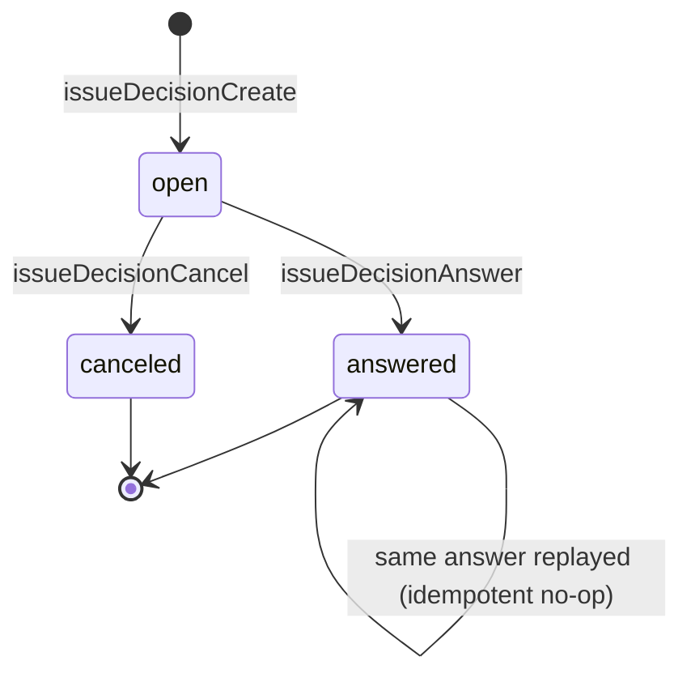

# Decisions (ask the user)

A decision is a question an agent asks while it is working on an issue, with optional
options, that a human answers in the product. Hoja keeps decisions on the server
(`issue_decision`) attached to one issue, so the question survives the agent's process,
the issue visibly reads "waiting on me", and the waiting agent can poll for the answer
without a browser.

The GraphQL surface lives in `hoja_server/decisions_api.py`; validation lives in
`hoja_server/decisions.py`. Both follow the extension and views conventions
([extensions](extensions.md), [views](views.md)): a declarative payload validated field by
field, one error type that names the offending field, and every write inside a single
transaction that also maintains the issue's flag.

## Why not a comment

A comment can hold the question but not the answer's shape. Nothing distinguishes an open
question from a remark, nothing fails an agent's "did anyone answer?" poll, and a board
cannot show which issues are blocked on a person. A decision is therefore a row with a
status, an optional option set, and an answer that is recorded once.

## GraphQL

```graphql
query { issue(id: "ENG-12") { decisionNeeded decisions(status: "open") { id question status } } }
query { issueDecisions(issueId: "ENG-12", status: "open") { id question options status } }

mutation($input: IssueDecisionCreateInput!) { issueDecisionCreate(input: $input) { success decision { id status } } }
mutation($id: String!, $input: IssueDecisionAnswerInput!) { issueDecisionAnswer(id: $id, input: $input) { success decision { id status chosenOption answer answeredBy { id } } } }
mutation($id: String!) { issueDecisionCancel(id: $id) { success } }
```

| Field | Meaning |
| --- | --- |
| `id` | Stable identifier; the agent polls by this. |
| `issue` | The issue the question is about. |
| `question` | The question text, 1–500 characters. |
| `options` | `[{key, label, description}]`, 0–10 entries. Empty means free-form. |
| `context` | Optional markdown detail, links, or reproduction steps. |
| `status` | `open`, `answered`, or `canceled`. |
| `askedBy` | The member whose credential asked (an agent's API key resolves to its user). |
| `askedByAgent` | Free-form agent/session identity the caller supplies, e.g. `claw:run-…`. |
| `answer` | The human's answer text. |
| `chosenOption` | The `key` of the chosen option when the decision offered options. |
| `answeredBy`, `answeredAt` | Who answered and when; set once. |
| `createdAt`, `updatedAt` | Timestamps. |

## State machine



* `open` is the only state that sets `Issue.decisionNeeded`.
* `answered` and `canceled` are terminal. Answering an answered decision with the *same*
  `chosenOption` and `answer` succeeds and returns the existing row unchanged, so an agent
  may retry a lost response; a *different* answer is refused with `ALREADY_ANSWERED` rather
  than silently overwriting the human's choice.
* `askedByAgent` never changes; `answeredBy` is written exactly once, by the first accepted
  answer.

## Composing with In Review

A decision does not introduce a new workflow state. "In Review" is a team-defined
`workflow_state` whose `type` is `started`; a decision is orthogonal to it, because a
question can block any state and a review can proceed without one. The two compose through
the issue flag:

| Issue state | Open decision | Board / list reads |
| --- | --- | --- |
| In Review | none | normal |
| In Review | one or more | `decisionNeeded: true`, flagged row/card, banner in the detail |
| any other | one or more | same flag: the question blocks regardless of state |

`Issue.decisionNeeded` is a maintained boolean column, not a per-row subquery, so a board
of a thousand issues costs one row read per issue. Creating an open decision sets it;
answering or canceling the last open decision clears it. The flag travels through the
existing realtime change feed (issue update events) and the local-first sync snapshot
(`decisionNeeded` joined `ISSUE_COLUMNS`), so a client that is already open updates without
a reload.

Because the flag rides on the issue row, an issue in In Review that needs a decision is
indistinguishable from any other issue to a filter or a saved view — filtering on
`state: In Review` and scanning the flag is enough, and no state machine changes are
required for teams that never use decisions.

## Agent path

An agent's API key authenticates as its member, so the same mutations are reachable over
MCP (`hoja_issueDecisionCreate`, `hoja_issueDecisions`, `hoja_issueDecisionAnswer`) and the
CLI:

```console
hoja decision ask ENG-12 --question "Is View a first-class entity?" \
    --option view="First-class entity" --option flag="Just a flag" \
    --context "Two Mor label concepts on HOJA-98 suggest naming is not settled." \
    --agent claw:run-30d5
hoja decision list ENG-12 --status open
hoja decision wait <decision-id> --timeout 900   # prints the answer, exits 0 when answered
```

`hoja decision wait` polls the `issueDecision` query; an agent that prefers a single call
can poll `issueDecisions(issueId, status: "open")` itself. The change feed is the push
counterpart: `issue_decision` inserts and updates publish `issueDecision` events, and the
issue row's flag change publishes an `issue` update, so a client subscribed to
`onEntityChange(['issue', 'issueDecision'])` learns about both ends of the round trip.

Answering is idempotent per decision (see the state machine), and every answer records
`answeredBy` and `answeredAt`; the answer is also written into the issue's activity feed as
`decisionAnswered` so the history reads in one place.

## Authorization and tenancy

* Every row carries `organization_id`; every read and write filters on it, and the
  PostgreSQL policies in `tests/rls_mode.py` classify the table by that column.
* Creating and canceling require the member to see the issue's team (`_require_team_visible`);
  canceling additionally requires the asker or a workspace admin.
* Answering requires the same team visibility: anyone who can read the issue may answer it,
  including a second agent acting for a human.
* A decision the viewer may not read — another organization's row, or one on an issue in a
  private team they are not on — is reported as `NOT_FOUND`, never as a permission error, so
  the id space does not leak.

## Limits

| Limit | Value |
| --- | --- |
| Question length | 500 characters |
| Options per decision | 10 |
| Option label | 120 characters |
| Option description | 280 characters |
| `context` | 10 000 characters |
| `askedByAgent` | 200 characters |
| Open decisions per issue | 20 (refused beyond, so an agent cannot flood a board) |
