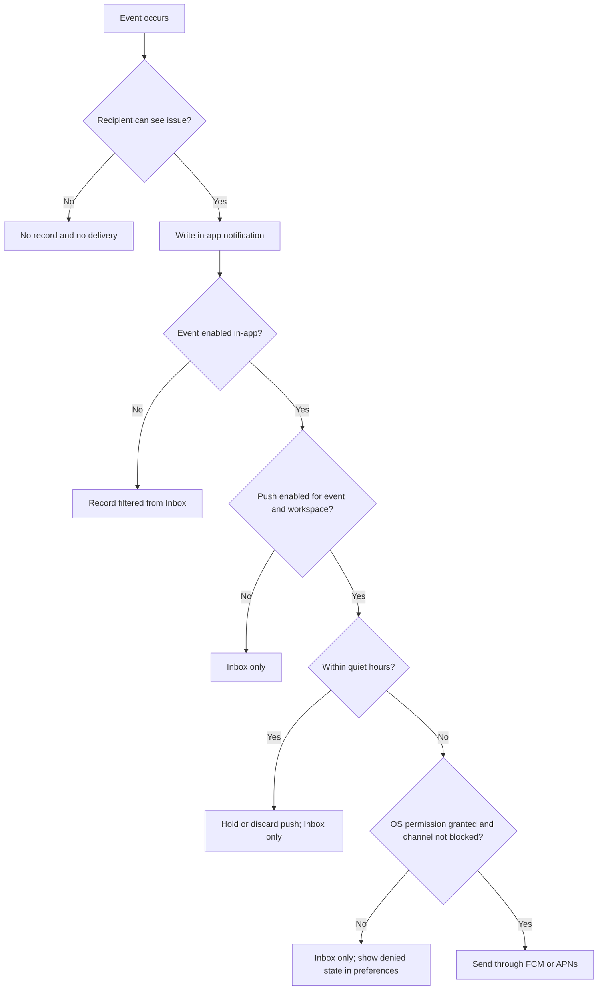

# Android notifications and shared notification UX

This guide defines the target behaviour for Hoja notifications on Android (Firebase
Cloud Messaging, FCM) and the notification experience that must be identical on
Android and Apple platforms. It contains 20 numbered user stories: 11 for Android
transport and rendering, and 9 for the shared in-app surface and preferences.
Together with the 20 stories owned by the Apple/APNs half, these make the 40-story
set requested in HOJA-155.

Story IDs are `AND-01` through `AND-20` so the Apple half (`IOS-01` through
`IOS-20`) can cite them without ambiguity. The Apple half currently lives at the
repository root in `docs/notifications/apple.md`; this file lives in the
application tree at `app/docs/notifications/android-and-ux.md`. The Apple half
refers to a future `docs/notifications/android.md`; when both halves merge, keep
them in one directory and update that cross-reference. The comparison below was
reconciled against the Apple half as it existed at the time of writing. That
file arrives in a sibling pull request, so the reference is not resolvable in
this branch alone.

## Verified starting point

The following was read from this repository at the time of writing, so the stories
describe real deltas rather than a greenfield design:

| Surface | What exists now | Gap |
| --- | --- | --- |
| Web Inbox | `/workspace/inbox` lists `inboxNotifications`, shows unread counts, marks one/all read, archives, paginates, and has empty and error states (`app/frontend/src/main.tsx`, `InboxPage`) | No workspace/project grouping, no swipe actions, no undo, no archived view |
| Notification records | `inbox_notification` rows with `kind`, `issue_id`, `actor_id`, `read_at`, `archived_at` (`app/hoja_server/db.py`) | Only `issueCreated` and `issueUpdated` are written; no comment, mention, due-date, or meeting events |
| Recipients | Assignee and creator of a task, excluding the actor (`_notify_issue_recipients`, `app/hoja_server/writer.py`) | No follower/subscriber model in the notification path |
| Preferences | `myNotificationPreferences` with two global booleans, `issueCreated` and `issueUpdated` (`app/hoja_server/resolvers.py`, `store.py`) | No per-workspace scope, no push/email columns, no quiet hours |
| Mobile app | Expo app with a connection screen, task list, task detail, status sheet, and account screen (`mobile/app/`); the credential is a workspace-scoped API key and there is no workspace switcher (`mobile/docs/vertical-slice-contract.md`) | No Inbox, no preference UI, no notification client; cross-workspace grouping has nothing to group yet |
| Push transport | Nothing installed: `mobile/package.json` has no `expo-notifications`, Firebase, or messaging dependency | FCM/APNs transport, token registry, and delivery worker are entirely new |

Nothing in this document is an implementation commitment. It is the product
contract that implementation and review are measured against.

## Protocol comparison

The two protocols are not symmetric. Android exposes a user-editable channel
model; Apple exposes a single app-level authorization plus per-notification
interruption levels. Any preference screen that pretends otherwise is lying about
what the operating system controls.

| Concern | Android (FCM) | Apple (APNs) | Product consequence |
| --- | --- | --- | --- |
| Transport | FCM registration token, delivered through Google Play services on devices with Play Store; FCM requires Android 7.0+ | APNs device token, delivered through the Apple Push Notification service | One delivery worker, two providers, one token registry with a `platform` column |
| Permission | `POST_NOTIFICATIONS` runtime permission on Android 13+; user can revoke at any time; app can query `areNotificationsEnabled()` | `UNUserNotificationCenter.requestAuthorization` prompts once; provisional authorization can send quietly before explicit approval | Ask in context on both; never infer permission from a stored token |
| Per-category user control | Notification channels are user-visible and individually configurable; channel importance can be changed by the user | No user-visible per-category switch equivalent to Android channels; categories are for actions, not user preference | Android preferences link to channels; Apple preferences must stay app-level. Cross-reference `docs/notifications/apple.md` |
| Importance | Channel `IMPORTANCE_HIGH/DEFAULT/LOW/MIN/NONE` controls heads-up, sound, status bar | Interruption levels (`passive`, `active`, `timeSensitive`, `critical`) plus Focus and Scheduled Summary | Define one Hoja urgency scale, then map it down to each platform; do not promise identical interruption |
| Display messages | FCM notification messages are displayed by the SDK when the app is backgrounded; data messages run app code | Every APNs payload is delivered to the app or its extensions; the system displays the alert from the `aps` dictionary | Do not use Android data-only messages for content that must survive a killed app |
| Background power management | Doze and App Standby defer network, jobs, and normal-priority FCM messages; high priority is for user-visible, time-sensitive content | Background delivery is subject to APNs and system scheduling; silent pushes are throttled and not guaranteed | Server must reconcile through GraphQL; push is a hint, not the source of truth |
| Collapsing | `collapse_key` applies to data messages; notification messages are always collapsible and ignore `collapse_key`. `tag` replaces an already-posted notification with the same tag | `apns-collapse-id` | Do not rely on `collapse_key` to group FCM-rendered notification messages; use a stable `tag` per task and app-posted notifications where tray replacement matters |
| Rich content | Provider-rendered messages support text, `image`, and `click_action` only; `BigTextStyle`, `BigPictureStyle`, action buttons, `RemoteInput`, and `InboxStyle` require the app to post the notification | Notification service/content extensions, `UNNotificationAction`, `UNTextInputNotificationAction`, `threadIdentifier` | Ship one information hierarchy; text is guaranteed, rich actions are best-effort and platform-specific |
| Grouping | App-posted notifications use `setGroup` + `setGroupSummary`; Android 7.0+ nests groups; provider-rendered messages and four or more ungrouped notifications are auto-grouped with device-dependent behaviour | `threadIdentifier` groups notifications in Notification Center | Group by task where the app draws the notification; never promise a custom group summary on the provider-rendered path |
| Token rotation | `onNewToken` fires on initial generation and when the app is restored, reinstalled, or its data is cleared | Device tokens also change and must be re-registered | The server must invalidate old tokens from provider feedback, never assume a token is permanent |

Sources: FCM Android client and message documentation, Android notification
channels, runtime permission, notification building/grouping, Doze/App Standby,
and Apple's UserNotifications documentation. Specific links are in
[Sources](#sources).

### Reconciliation with the Apple half

Two Android rows in the Apple comparison need this document's correction:

- **Permission timing.** The Apple half says the Android 13+ prompt is
  "automatically triggered by the operating system" and appears only after a
  channel exists. That is accurate for an app targeting Android 12L (API 32) or
  lower. An app targeting Android 13+ controls when it requests
  `POST_NOTIFICATIONS`. AND-06 requires targeting 13+ and still creates channels
  before the request, because that is the correct order for the pre-13 fallback.
- **Channels before the prompt.** Both halves agree that Android must create its
  channels before any notification. On 13+ this is required to post, not to
  prompt; on 12L and lower it is also what triggers the system prompt. The
  shared screen must therefore create channels during startup, not lazily when a
  notification arrives.

## FCM rules these stories rely on

These are verified platform rules from the Android and Firebase documentation,
not Hoja policy:

- FCM clients require Android 7.0 or higher and the Google Play Store app, or an
  emulator with Google APIs.
- The current token is obtained with `FirebaseMessaging.getInstance().getToken()`.
  `onNewToken` fires when a token is initially generated and when it changes
  because the app is restored on a new device, reinstalled, or its data is
  cleared. The token may rotate after startup, so fetching once is insufficient.
- Notification messages are handled by the FCM SDK when the app is in the
  background and appear in the system tray. Data messages are always handled by
  app code. A message with both payloads delivers the notification to the tray in
  the background, and the data payload arrives in the tap intent.
- While in Doze, normal-priority messages may be delayed until a maintenance
  window. High priority is for time-sensitive, user-visible content; FCM may
  deprioritise high-priority messages that repeatedly do not produce a visible
  notification.
- A registration token is invalidated when the app is uninstalled; later sends
  return `NotRegistered`/`UNREGISTERED`.
- Since Android 8.0, every notification must belong to a channel. Channel
  importance and behaviour cannot be changed by the app after creation; only the
  user can change them. The user interface calls channels "categories".
- Newly installed apps on Android 13+ have notifications off by default until the
  runtime permission is granted. A denial blocks all channels except specific
  exemptions. Upgrades can be pre-granted only for eligible apps.
- Notification groups require a group summary to nest correctly; four or more
  ungrouped notifications may be grouped automatically by the system, with
  device-dependent behaviour.
- OEM Android builds differ: battery managers on vendors such as Xiaomi, Samsung,
  OnePlus, Huawei, Oppo, and Vivo are known to delay or kill background work.
  Hoja cannot override that; it can only explain it. The vendor guidance is
  maintained by `dontkillmyapp.com`.

### Provider-rendered versus app-rendered notifications

This distinction decides what is possible. There are two rendering paths, and a
story that ignores it promises UI Android cannot produce.

| Path | Who draws it | What the payload can set | Limits |
| --- | --- | --- | --- |
| FCM notification message, app backgrounded | FCM/Google Play services | `title`, `body`, `icon`, `color`, `sound`, `tag`, `click_action`, `channel_id`, `visibility`, `notification_count`, `notification_priority`, and `image` (downloaded on device, 1 MB limit) | No custom action buttons, no inline reply, no group key, no `BigTextStyle`/`setGroupSummary` control |
| App-posted notification, from the foreground or a data message | Hoja code using `NotificationCompat` | Full Android API: actions, `RemoteInput`, `BigTextStyle`, `BigPictureStyle`, `setGroup`, `setGroupSummary`, arbitrary `PendingIntent`s | The app must be running to receive a data message; Android may delay or drop it in Doze, and a force-stopped app receives nothing |

The provider-rendered path is the reliable one for a user-visible notification
when the app is not running. The app-rendered path is the rich one. Every story
below states which path it means. Rich actions are best-effort by definition, not
guaranteed, and the product must not claim otherwise.

The default for every event is the provider-rendered notification message. An
event moves to the app-rendered path only when the product explicitly accepts the
reliability trade-off (for example, an inline reply on a comment). A data-message
event must never be described as guaranteed.

## Recommended event taxonomy

This is the "what should we notify" answer. It is deliberately smaller than the
set of things Hoja records. Every event below becomes an in-app record; push and
email are separate choices.

Urgency uses one Hoja scale: `urgent` (heads-up candidate), `normal` (sound, no
heads-up), `low` (no sound, no status bar), `silent` (in-app only).

| Event key | Trigger | Recipients | In-app | Push default | Email default | Urgency / suggested TTL |
| --- | --- | --- | --- | --- | --- | --- |
| `issue.assigned` | Task's assignee becomes me | New assignee | Yes | Yes, `assignments` channel | Opt-in | Urgent, 1 hour |
| `issue.created_for_me` | Task created with me as assignee | Assignee | Yes | Yes, `assignments` | Opt-in | Normal, 24 hours |
| `comment.mention` | I am @mentioned in a comment or description | Mentioned member | Yes | Yes, `mentions` | Opt-in immediate | Urgent, 1 hour |
| `comment.on_followed` | Comment on a task I created, am assigned, or follow | Participants except actor | Yes | Yes, `updates` | Digest only | Normal, 24 hours |
| `issue.status_changed` | Status changes on a task I follow | Assignee, creator, followers | Yes | Yes, `updates` | Off | Normal, 24 hours |
| `issue.priority_changed` | Priority becomes urgent or high on a task I follow | Assignee, creator | Yes | Yes, `updates` | Off | Normal, 24 hours |
| `issue.due_soon` | Due date is within 24 hours or has passed | Assignee | Yes | Yes, `reminders` | Off | Normal, until due + 1 day |
| `meeting.invite` | I am invited to a meeting | Invitee | Yes | Yes, `reminders` | Opt-in | Urgent, until meeting start |
| `project.update` | A project I follow gets a status update | Project members | Yes | No; digest | Off | Low, daily digest |
| `cycle.boundary` | A team cycle starts or ends | Team members | Yes | No; digest | Off | Low, daily digest |
| `security.new_device` | A new device or API key is used for my account | Account owner | Yes | Yes, `security` | Yes | Urgent, 1 hour |

`security.new_device` is the one event where email is on by default: account
security should not depend on notification permission.

### Do not notify

The following are explicitly out of scope for push and email. Some may still
appear in activity history, but they must not create a notification record or
queue a push:

- My own actions. The actor is always excluded; this is already true in
  `_notify_issue_recipients`.
- Assignee changes away from me. The new assignee is notified; the previous one
  is not.
- Description-only edits that contain no mention.
- Label add/remove, estimate edits, and backlog ordering changes.
- Automatic cycle assignment and other housekeeping writes.
- Bulk imports, backfills, migrations, and API retries.
- Read receipts, "someone viewed this", presence, and typing indicators.
- Repeated status changes on the same task inside a ten-minute window; collapse
  them into one notification.
- Marketing, product announcements, and tips. Those belong in in-app messaging or
  email, never push.
- Any event whose recipient cannot currently access the task. Authorisation is
  evaluated before a push is queued, not after.
- A separate push for every device. One logical notification may fan out to
  multiple tokens, but the user sees one event.

## Android channel and urgency mapping

Create this small, stable set when the app starts, before any notification is
posted. The app cannot change importance after creation, so treat the IDs as a
versioned contract.

| Channel ID | User-visible name | Importance | Heads-up? | Used for |
| --- | --- | --- | --- | --- |
| `assignments` | Assignments | `IMPORTANCE_HIGH` | Candidate | `issue.assigned`, `issue.created_for_me` |
| `mentions` | Mentions and replies | `IMPORTANCE_HIGH` | Candidate | `comment.mention` |
| `updates` | Task updates | `IMPORTANCE_DEFAULT` | No | Comments on followed tasks, status and priority changes |
| `reminders` | Reminders and meetings | `IMPORTANCE_DEFAULT` | No | Due-soon and meeting invitations; time-sensitive escalation needs a separate product decision |
| `digests` | Digests | `IMPORTANCE_LOW` | No, no status bar | Project updates and cycle boundaries |
| `security` | Account security | `IMPORTANCE_HIGH` | Candidate | New device or API key |

Android's user-visible importance mapping is: Urgent = sound and heads-up;
High = sound; Medium = no sound; Low = no sound and no status bar; None = not
shown at all. The system and the user can override any of this, so the product
must describe the intent, not guarantee the result.

## Stories

Priority: **P0** is required for a notification launch, **P1** is the next
release, **P2** can follow without blocking. Every story is a product contract,
not a statement that the code exists.

## Android transport and rendering

### AND-01. Register this device for push

**As a** signed-in member on Android, **I want** the app to register this device
with Hoja after I sign in, **so that** task notifications can reach me without
keeping Hoja open.

**Acceptance criteria**

- After a successful sign-in, and on each app start, the app obtains the current
  FCM registration token with `getToken()` and uploads it with an authenticated
  request scoped to the signed-in user and workspace.
- The upload is idempotent: the same token for the same installation updates one
  record instead of creating duplicates.
- The token is associated with the user and an installation identifier, not with
  a device serial or an advertising identifier, and is never written to logs or
  analytics.
- A failed upload retries with backoff and never blocks the tasks list; Settings
  exposes the last successful registration time and a manual retry.
- Signing out removes the token association for this installation so a shared
  device stops receiving the previous member's notifications.
- The registry can answer "which tokens are active for this user and workspace"
  without scanning client state.

**Priority:** P0

**Uncertainty:** the upload endpoint and token table do not exist yet; this story
requires an API design before implementation.

### AND-02. Rotate and invalidate tokens

**As a** member who restored to a new phone, reinstalled the app, or cleared app
data, **I want** my registration to follow me, **so that** I do not silently stop
receiving work and old devices do not keep receiving it.

**Acceptance criteria**

- `onNewToken` uploads the new token and supersedes the previous token for the
  same installation, whether the callback fires at first generation or after a
  rotation.
- The app re-checks the token when it returns to the foreground and uploads it if
  the value changed, because a token can rotate after initial startup.
- A send that returns `UNREGISTERED`/`NotRegistered`, or an equivalent permanent
  provider error, marks the token inactive; the sender does not retry it
  indefinitely.
- Old tokens are retained only as inactive rows for audit and are never selected
  for delivery.
- A user who switches accounts on one installation moves the token to the new
  account; the previous account no longer targets it.
- Verification covers fresh install, reinstall, clear-data, account switch, and
  restore-to-new-device.

**Priority:** P0

### AND-03. Use tokens for people and topics only for broadcasts

**As a** workspace security owner, **I want** a documented targeting rule,
**so that** task content cannot leak through a public subscription mechanism.

**Acceptance criteria**

- Anything recipient-specific is sent to registration tokens, not to an FCM
  topic. This includes task titles, comments, and mentions.
- Topics are used only for non-sensitive, workspace-independent announcements
  such as a release note, and never carry task or member data.
- The server resolves recipients from workspace membership and task visibility
  before queueing a message; a token belonging to a removed member is not used.
- Per-user and per-workspace preferences are evaluated at send time, not only at
  subscription time.
- The client never subscribes to a topic as a proxy for project or team
  membership, because topics cannot enforce authorisation.
- Topic use, if any, is documented with its subscription lifecycle; FCM limits
  one app instance to 2,000 topics and rate-limits subscription changes.

**Priority:** P0

### AND-04. Choose notification or data messages deliberately

**As a** member, **I want** a notification to appear whether Hoja is open or not,
**so that** I do not need to keep the app running to learn about work.

**Acceptance criteria**

- Every user-visible event is sent as an FCM notification message, optionally
  with a data payload carrying `workspaceId`, `issueId`, `notificationId`, and
  `kind`.
- The notification payload uses only fields FCM can render (title, body, icon,
  colour, sound, tag, click action, channel, visibility, notification count, and
  image). It does not assume action buttons or a group summary on the
  provider-rendered path.
- When Hoja is in the foreground, `onMessageReceived` receives the message; the
  app shows an in-app banner or refreshes the Inbox and does not double-post a
  tray notification for the same event.
- When Hoja is in the background, FCM displays the notification and the data
  payload is available when the user taps it.
- Data-only messages are limited to background hints such as "Inbox changed";
  they are never the only carrier of content that must survive a killed app.
- A tap opens the target task and marks the record read only after the target
  loads successfully.
- `onMessageReceived` does no work beyond a few seconds; anything longer is
  scheduled with WorkManager.
- An event that needs app-rendered actions is sent as a data message only after a
  documented decision that the reduced delivery guarantee is acceptable; it is
  never silently substituted for the provider-rendered path.

**Priority:** P0

### AND-05. Be honest under Doze, App Standby, and OEM battery managers

**As a** member who leaves my phone idle, **I want** urgent notifications to
arrive promptly and routine ones to wait, **so that** I am not woken for noise or
drained by background work.

**Acceptance criteria**

- Only `urgent` events use FCM high priority. Normal events use normal priority
  and are allowed to wait for a Doze maintenance window.
- Every event class declares a TTL, so an assignment or mention that is hours old
  is discarded rather than delivered late; default FCM storage of four weeks is
  not acceptable for work notifications.
- The app reconciles missed pushes by querying `inboxNotifications` on foreground
  and on reconnect; the Inbox, not the tray, is the record of truth.
- Settings includes a "Notifications not arriving?" help section with
  vendor-specific battery-optimisation steps and a link to the Android
  notification settings for Hoja. It does not silently request
  `REQUEST_IGNORE_BATTERY_OPTIMIZATIONS`, which is a restricted Play permission.
- The app reports token validity, last successful sync, and last received push
  time (no message content) in a diagnostic view.
- Device verification includes at least one aggressive OEM build and `adb` Doze
  simulation. Until those runs are recorded, delivery latency is **unknown**, not
  "instant".

**Priority:** P0

### AND-06. Ask for `POST_NOTIFICATIONS` in context

**As a** member on Android 13 or newer, **I want** to be asked for notification
permission when I understand the benefit, **so that** I can make an informed
choice.

**Acceptance criteria**

- The manifest declares `POST_NOTIFICATIONS`; the request is made only on
  Android 13+ (`SDK_INT >= 33`). Below 13, channel creation and the system flow
  apply.
- All notification channels are created during startup before the permission
  request, so the pre-13 fallback still has a channel and the 13+ prompt follows
  an already-understandable category model.
- The first request follows a user action or a value moment, such as enabling
  push in Settings or receiving a first assignment, not app launch.
- Before the system prompt, the app explains what will be sent and offers a
  "Not now" path that leaves the app usable.
- Allow, deny, and swipe-away are all handled; swipe-away leaves the permission
  state unchanged.
- The app checks `areNotificationsEnabled()` rather than assuming a stored token
  means permission is granted.
- When `shouldShowRequestPermissionRationale()` is true, an in-app rationale is
  shown before requesting again; after a permanent denial the app links to system
  settings instead of re-prompting.
- Denial never blocks the tasks list, the Inbox, or sign-in.

**Priority:** P0

### AND-07. Expose a stable Android channel model

**As a** member, **I want** separate Android categories for assignments,
mentions, updates, reminders, digests, and security, **so that** I can silence
status churn while keeping work that needs me.

**Acceptance criteria**

- The app creates the channels in the mapping table on start, before any
  notification is posted; creating an existing channel is a no-op.
- Each channel has a stable ID, a user-visible name, and a description that
  explains what it carries.
- Every posted notification names its channel; a notification without a channel
  never reaches the system on Android 8.0+.
- The app does not change channel importance after creation and does not try to
  work around a user's choice.
- Settings > Notifications reads the current channel importance and offers an
  "Open Android settings" action for that channel, using
  `ACTION_CHANNEL_NOTIFICATION_SETTINGS`.
- The event-to-channel mapping is fixed in one shared table used by the sender and
  the preference UI.
- Channels are app-level, not per task; per-workspace channels would require
  channel groups and are deferred until multi-workspace mobile support exists.
- The UI explains the divergence: Android users can change these categories in
  system settings; Apple's equivalent control is app-level, as documented in the
  Apple half.

**Priority:** P0

### AND-08. Map channel importance to heads-up versus silent

**As a** member, **I want** only truly urgent work to interrupt my screen,
**so that** routine updates stay quiet and predictable.

**Acceptance criteria**

- `IMPORTANCE_HIGH` channels are the only candidates for a heads-up notification;
  `IMPORTANCE_DEFAULT` may make a sound but does not peek;
  `IMPORTANCE_LOW`/`MIN` do not sound or appear in the status bar.
- The product never promises a heads-up: Do Not Disturb, screen state, user
  settings, and the system can suppress it.
- `issue.assigned` and `comment.mention` default to urgent; comments on followed
  tasks, status changes, and priority changes default to normal; project and
  cycle updates default to low; digests never sound.
- High-priority FCM is never used for a message that does not produce a visible
  notification, because FCM may deprioritise that pattern.
- The preference screen shows the user-visible importance meaning next to each
  Android channel, not the raw constant.
- A user who lowers a channel's importance keeps receiving the event in the
  Inbox; only the interruption changes.

**Priority:** P0

### AND-09. Act on a notification without opening the app

**As a** member, **I want** to mark a task read, archive it, or reply to a
comment from the notification, **so that** quick acknowledgements take seconds.

**Acceptance criteria**

- Every notification opens its task on tap. Mark read, Archive, and inline reply
  are available only on the app-posted path, because FCM-rendered notification
  messages cannot carry custom actions.
- When the app posts the notification, it adds Open, Mark read, and Archive (and
  inline reply for comments where supported); each action uses a distinct
  `PendingIntent` request code so actions cannot cross wires.
- Mark read and Archive call the same mutations as the Inbox
  (`notificationMarkRead`, `notificationArchive`) and are idempotent when the app
  later reconciles.
- Inline reply appears only for comment notifications once the mobile app and
  backend support posting comments. It uses `RemoteInput`, posts the comment,
  and replaces the notification with a confirmation; a failure leaves a retry
  affordance. Because it can only be offered on an app-posted notification, it is
  best-effort and never the only way to reply.
- If inline reply is not supported, the notification shows no reply affordance;
  it must not offer a control that silently does nothing.
- Actions that write are hidden for a read-only API key and produce a clear
  permission message if attempted.
- System-generated reply/action suggestions are disabled unless deliberately
  designed, using `setAllowGeneratedReplies` and
  `setAllowSystemGeneratedContextualActions`.

**Priority:** P1

**Uncertainty:** the mobile app has no comment composer today, so inline reply
depends on a comment API and UI that do not exist in this client.

**Decision required:** if inline reply is judged important enough to justify
data-message delivery, measure its delivery rate on Doze and OEM devices before
shipping. If it is not, comment notifications remain Open-only in the tray and
reply happens in the app.

### AND-10. Provide enough rich content to decide

**As a** member, **I want** the notification to show the task, actor, and
relevant context, **so that** I can judge whether to open it without unlocking my
phone for a surprise.

**Acceptance criteria**

- Provider-rendered collapsed content shows the task identifier, title, actor,
  and workspace or team in a predictable order, truncated rather than wrapped
  unpredictably.
- Provider-rendered expanded content may use the payload `image` field for one
  Hoja-hosted image; Android downloads it on device, enforces a 1 MB limit, and
  may fail without affecting the text notification.
- App-posted content additionally uses `BigTextStyle` for a description excerpt
  or comment and `BigPictureStyle` for an already-downloaded bitmap.
- The payload stays within the 4 KB FCM limit; large bodies and multiple images
  are never embedded. No background-rendered notification depends on app code
  running to fetch content.
- Lock-screen visibility defaults to hidden content: the notification says
  "New Hoja activity" (or the event-specific placeholder in AND-16) and no task
  title, description, actor, or comment body. A member may opt into
  title-only or title-and-detail previews in AND-16.
- No custom `RemoteViews` layout is used; Android 12+ restricts custom
  notification layouts and the standard templates are sufficient.
- The same information hierarchy is used on Apple platforms, with richer Apple
  extensions only if the Apple half specifies them.

**Priority:** P1

### AND-11. Group related notifications

**As a** member with several updates on one task or project, **I want** them
grouped under a summary, **so that** my notification shade is not flooded.

**Acceptance criteria**

- Every FCM-rendered notification uses a stable `tag` derived from the task ID
  and kind, so a newer event on the same task replaces the older tray entry
  instead of stacking.
- When the app posts notifications, notifications for the same task share a
  stable `setGroup` key and a summary with a stable ID uses `InboxStyle` to list
  the latest children.
- Only one summary exists per group; adding a child updates the existing summary
  rather than posting a second one.
- Group alert behaviour is explicit: the summary does not also sound when the
  children have already alerted.
- Tapping a child opens that task; tapping the summary opens the Inbox filtered
  to unread.
- Reading or archiving an item in the Inbox cancels the corresponding tray
  notification where the platform allows it, so the two surfaces do not
  contradict each other.
- The product does not claim a per-task group summary for provider-rendered
  background messages; the FCM payload cannot set a group key. In that path it
  relies on `tag` replacement and Android's automatic grouping, and documents
  that automatic behaviour varies by device.

**Priority:** P1

## Shared Inbox and preferences

### AND-12. One chronological Inbox with real read state

**As a** member, **I want** one list of everything that needs my attention,
**so that** I do not hunt across projects to find out what changed.

**Acceptance criteria**

- The Inbox lists notifications newest first with cursor pagination, a stable
  cursor, and a load-more action; a cursor that does not advance is an error, not
  a silent loop.
- Each row shows task identifier and title, actor, event description, relative
  time, workspace/team/project, and a read/unread marker.
- The unread count comes from the server and is adjusted by local optimistic
  edits; it is not recomputed from only the loaded page.
- The badge and the Inbox show the same number: unread notification records, not
  open tasks. If the badge is unavailable on a launcher, the in-app unread
  indicator is still authoritative.
- Mark read and archive apply optimistically, roll back on failure, and surface
  an action error.
- The first page is cached per viewer and workspace for instant paint, then
  revalidated when a notification changes and when the app returns to the
  foreground.
- Android and the web use the same GraphQL fields and event text so the same
  notification reads identically on both.
- Every row has an accessible name that identifies the task and the action.

**Priority:** P0

### AND-13. Group the Inbox by workspace and project

**As a** member in several workspaces, **I want** the Inbox grouped by context,
**so that** I can triage one workspace or project at a time.

**Acceptance criteria**

- The grouping selector offers None, Workspace, Project, and Team; the default on
  mobile is Workspace and the choice persists per device.
- Group headers show a name and count; collapsing a group preserves the state
  across visits.
- Workspace grouping never merges identically named projects from different
  workspaces.
- Only workspaces the credential can access are shown; a workspace whose access
  was revoked disappears with its items.
- Because the current mobile credential resolves exactly one workspace, the mobile
  Inbox shows that workspace only and Workspace grouping is a single header until
  a multi-workspace credential exists. The web Inbox may group across the
  member's workspaces; the screen must not imply a switcher the client cannot
  provide.
- Grouping is a view over the same read state; changing it never mutates server
  data.
- Flat chronological order remains available and is the fallback when grouping
  data is missing.

**Priority:** P1

### AND-14. Mark all read and swipe with undo

**As a** member, **I want** fast bulk and gesture actions that can be undone,
**so that** clearing the Inbox is quick and a mistake is recoverable.

**Acceptance criteria**

- Swipe left archives; swipe right toggles read/unread. Both have an accessible
  button or menu equivalent, and the swipe threshold is announced by
  accessibility services.
- Archive and read toggles show an undo affordance for at least five seconds and
  restore the exact prior state **only when the server supports the reverse
  operation**. Today the backend has neither `notificationUnarchive` nor
  `notificationMarkUnread`, so a truthful first version either adds both
  mutations or confirms destructive actions instead of offering a fake undo.
- "Mark all as read" states its scope before applying. If the API only supports
  all-notifications marking, the copy says "all workspaces"; a scoped version
  requires a scoped mutation, which does not exist today.
- If only one of the reverse operations is added, only that action gets undo;
  the other keeps a confirmation step.
- Failed actions roll back their row and show a retry, without discarding the
  rest of the list.
- Archived items are reachable through an Archived filter, because
  `inboxNotifications(archived: true)` already exists on the server.

**Priority:** P1

### AND-15. Make empty, offline, and error states truthful

**As a** member, **I want** to know whether there is nothing new, whether Hoja is
offline, or whether something failed, **so that** I do not mistake silence for
success.

**Acceptance criteria**

- A truly empty Inbox explains what will appear there and that history begins at
  the event-log migration; it does not imply older activity was read.
- The unread-filter empty state says "No unread notifications" and offers a way
  to show all.
- The initial load has a loading state; load-more shows progress and never
  duplicates rows.
- A first-page error shows a retry; an action error keeps the list and marks the
  affected row.
- Offline shows the cached list with a stale banner; because this client has no
  offline write queue, read and archive actions require a connection and fail
  with a clear message rather than pretending to succeed.
- A 401 clears the credential path and routes to sign-in without exposing
  workspace content.

**Priority:** P0

### AND-16. Preferences matrix: event type by channel, per workspace

**As a** member, **I want** to choose which events reach me and through which
channel for each workspace, **so that** Hoja respects my attention instead of
deciding for me.

**Acceptance criteria**

- The screen shows a matrix of event types from the taxonomy against In-app,
  Push, and Email, with an "All workspaces" default and per-workspace overrides.
- On the current single-workspace mobile credential, the selector shows that one
  workspace and the "All workspaces" row is omitted rather than shown as a
  no-op; the web client keeps the global default.
- In-app is the record of truth and is on by default; disabling an event type in
  In-app also suppresses its push and email so the user cannot create a push with
  no visible record.
- Push is disabled, with an explanation and an OS-settings link, when the
  platform permission is denied or no device is registered. It is never shown as
  "on" when the operating system blocks it.
- Email is shown only when the server has email configured; otherwise it is
  disabled with the same honesty the current settings page uses ("Email delivery
  is not available").
- Preferences persist server-side per user and workspace, and the delivery worker
  reads them; the client is not the only enforcement point.
- Saves are optimistic, roll back on failure, and announce success or failure.
- On Android each push row identifies its channel and shows the OS channel's
  current importance. On Apple the row states that interruption is controlled by
  the app-level system permission and Focus, not by a per-category OS switch.
- A "Content on lock screen" control offers Hide all, Title only, and Title and
  detail. It defaults to Hide all. Placeholders are exact, content-free strings:
  "New Hoja activity", "New assignment", "New mention", "New comment",
  "Task updated", "Reminder", "Account security". On Android this maps to
  `VISIBILITY_PRIVATE` and the channel's lock-screen visibility, which the user
  can override; on Apple the system's own Show Previews setting wins, so the app
  must say that it cannot override it.

**Priority:** P0

### AND-17. Quiet hours that mean what they say

**As a** member, **I want** quiet hours in my timezone, **so that** work
notifications do not wake me and are not silently delivered at 3 a.m. anyway.

**Acceptance criteria**

- The member sets a start time, end time, IANA timezone (defaulting to the device
  timezone), and applies the schedule on chosen days of the week.
- Quiet hours suppress push at the server before delivery; they do not post a
  silent notification that still appears in the tray. In-app records are still
  created.
- The member chooses either "hold until quiet hours end" (one digest, not a
  burst) or "discard push, keep in-app".
- An opt-in "allow urgent mentions during quiet hours" switch exists and is off
  by default; the default respects quiet hours for every event.
- Email is not affected unless the member separately opts in.
- The screen shows the next quiet start and end in local time and handles a
  timezone or DST change without extending or skipping the window incorrectly.
- The copy distinguishes Hoja quiet hours from the phone's Do Not Disturb, which
  still applies on top.

**Priority:** P1

### AND-18. Degrade honestly when permission is denied

**As a** member who declined notifications, **I want** the app to remain useful
and tell me the truth, **so that** I can change my mind without guessing which
switch is lying.

**Acceptance criteria**

- The app detects the OS state on both platforms: Android uses
  `areNotificationsEnabled()` plus channel importance; Apple's exact authorization
  query is defined in `docs/notifications/apple.md` rather than duplicated here.
- A persistent, dismissible-for-this-session banner says push is off and offers
  an action that opens the system settings for Hoja.
- The push column in preferences shows "Off in Android settings" or the Apple
  equivalent; saved app-level preferences remain stored and are not silently
  flipped to off, so re-enabling restores them.
- The Inbox continues to load on open and foreground; in-app unread counts and
  the Inbox badge still work.
- After a denial, the app does not loop the permission prompt. It re-asks only
  after a user action or after the user returns from settings.
- The app never reports "push is on" based only on the existence of a server
  token.
- If an Android channel is set to `IMPORTANCE_NONE`, the preference row says that
  category is blocked even when app notifications are allowed.

**Priority:** P0

### AND-19. Route a tap to the exact destination

**As a** member, **I want** a notification tap to open the task or comment it
refers to, **so that** I do not lose context or land in the wrong workspace.

**Acceptance criteria**

- Payload routing data includes workspace, task, notification, and kind, and the
  app validates that the signed-in credential can access the workspace and task.
- Cold start, warm start, and resume from background all reach the same
  destination and preserve a sensible back stack to the Inbox.
- A comment event scrolls to the comment when the client supports anchors; if it
  does not, it opens the task without pretending to highlight a comment.
- A deleted, archived, or inaccessible task opens an explanatory state with a
  route back to the Inbox, never a blank screen or another workspace's data.
- The notification is marked read only after the destination loads; a failed
  load leaves it unread.
- The same route works from universal/app links and from the notification, using
  one shared resolver.

**Priority:** P0

### AND-20. Enforce a fixed event taxonomy and do-not-notify list

**As a** product owner, **I want** a small, explicit event list with enforced
exclusions, **so that** notifications remain trustworthy instead of becoming a
firehose.

**Acceptance criteria**

- Every notification kind maps to a stable event key in the taxonomy; an unknown
  key is stored in-app but never pushed.
- Recipient selection excludes the actor, enforces workspace and task
  visibility, and respects the recipient's per-event, per-channel prefs.
- The do-not-notify list is enforced in code paths that create notifications, not
  only in documentation: self-actions, description-only edits, label and estimate
  edits, bulk imports, read receipts, presence, marketing, and inaccessible
  tasks produce no push.
- Repeated events on one task are coalesced within a documented window; the
  default is ten minutes for status and priority changes.
- A per-user rate limit and a daily digest ceiling are defined and observable, so
  a loop or a bulk operation cannot send hundreds of pushes.
- Every event still creates an in-app record when push or email is disabled, so
  the Inbox remains a complete history from the migration point onward.
- Adding a new event requires updating the taxonomy, the channel mapping, the
  default preference, and the tests in the same change.

**Priority:** P0

## Delivery model

The pieces fit together as follows. The provider is a transport, not the source
of truth; the Inbox is.

```mermaid
sequenceDiagram
    autonumber
    participant A as Actor
    participant H as Hoja server
    participant W as Delivery worker
    participant F as FCM
    participant D as Android device
    A->>H: change issue or comment
    H->>H: authorise recipients and write inbox_notification rows
    H->>W: enqueue event and notification ids
    W->>W: apply prefs, quiet hours, coalesce, token validity
    alt push enabled and permission recorded
        W->>F: notification message with data payload
        F-->>D: background tray notification
        D->>H: tap opens issue (deep link)
        D->>H: Inbox reconciles via GraphQL
    else push off or denied
        W-->>H: no push; record remains
        D->>H: Inbox shows record on next open
    end
```

Permission and preference are two independent gates. A stored token is not
permission, and an app preference is not an OS grant.



## Answers to the shared UX questions raised by the Apple half

The Apple document asks four questions and defers them to this half. These are
the decisions:

1. **Global or per workspace?** Global by default with per-workspace overrides.
   The web settings screen opens on "All workspaces" and a workspace selector
   narrows it; the current single-workspace mobile credential shows that one
   workspace instead of a fake global row. The delivery worker evaluates the
   workspace override first, then the global default. A workspace with no
   override inherits the global value.
2. **What does the badge count?** Unread notification records, identical to the
   Inbox unread count. It does not count open tasks and does not give comments a
   separate badge. The number must equal the list the member sees, including
   optimistic read state; cap the displayed badge at 99+ where the platform
   supports a text badge. Android launchers may not render badges at all, so the
   in-app unread indicator is the reliable affordance.
3. **What are the hidden-content placeholders?** "New Hoja activity" (generic),
   "New assignment", "New mention", "New comment", "Task updated", "Reminder",
   and "Account security". They contain no task identifier, title, actor,
   project, or workspace name. The member opts into title-only or
   title-and-detail previews in AND-16; the default is hidden.
4. **Does the app show its own in-app toast?** Yes, once. When the app is in the
   foreground, show one in-app banner for the event and do not also post a tray
   notification for the same record. If the member is already viewing the
   affected task, update the view and mark the record read instead of showing a
   banner. On Android this is decided in `onMessageReceived`; on Apple the
   foreground presentation options suppress the system banner.

These answers are part of the contract for AND-04, AND-12, AND-16, and AND-19.
The Apple half may have to cite them rather than restate them.

## Open questions and uncertainty

These are flagged rather than asserted:

- **Per-workspace preferences:** the current backend stores preferences globally
  per user (`user_preferences` keys prefixed `notification:`). The taxonomy and
  AND-16 require a workspace dimension; the schema change is not designed here.
- **Comments and mentions:** the database has a `comment` table, but the mobile
  client has no comment composer. AND-09's inline reply and `comment.*` events
  depend on comment APIs and a mobile UI that do not exist in this client.
- **Email:** `docs/email-delivery.md` and the email adapter exist, but the current
  notifications settings page explicitly says email delivery is unavailable. Do
  not turn on an email column until the server can send it.
- **FCM high-priority latency:** Doze and OEM behaviour cannot be proven from
  documentation alone. AND-05 requires device runs; until then, expected latency is
  unknown.
- **Apple comparison:** the Apple column is provisional until
  `docs/notifications/apple.md` lands. Do not let the two docs disagree on
  permission, interruption levels, or grouping.
- **Android 13 pre-grant:** upgrades from a pre-13 install can be pre-granted only
  when the app already had a channel and notifications were not disabled. Do not
  assume every existing user starts granted.

## Sources

- FCM Android client setup and token lifecycle:
  https://firebase.google.com/docs/cloud-messaging/android/client
- FCM message types, collapsing, priority, TTL, and invalid-token behaviour:
  https://firebase.google.com/docs/cloud-messaging/concept-options
- FCM receive behaviour and background/foreground routing:
  https://firebase.google.com/docs/cloud-messaging/android/receive
- FCM message priority and deprioritisation:
  https://firebase.google.com/docs/cloud-messaging/android/message-priority
- FCM topic messaging and limits:
  https://firebase.google.com/docs/cloud-messaging/android/topic-messaging
- FCM HTTP v1 `AndroidNotification` fields (including `tag`, `click_action`,
  `visibility`, and `image`):
  https://firebase.google.com/docs/reference/fcm/rest/v1/projects.messages
- Android notification channels and importance:
  https://developer.android.com/develop/ui/views/notifications/channels
- Android 13 notification runtime permission:
  https://developer.android.com/develop/ui/views/notifications/notification-permission
- Android notification building, actions, and inline reply:
  https://developer.android.com/develop/ui/views/notifications/build-notification
- Android notification grouping:
  https://developer.android.com/develop/ui/views/notifications/group
- Android expandable notifications and `BigPictureStyle`:
  https://developer.android.com/develop/ui/compose/notifications/expanded
- Doze and App Standby:
  https://developer.android.com/training/monitoring-device-state/doze-standby
- OEM battery-management behaviour:
  https://dontkillmyapp.com/
- Apple notification authorization:
  https://developer.apple.com/documentation/usernotifications/asking-permission-to-use-notifications
- Apple remote notification payloads:
  https://developer.apple.com/documentation/usernotifications/generating-a-remote-notification
